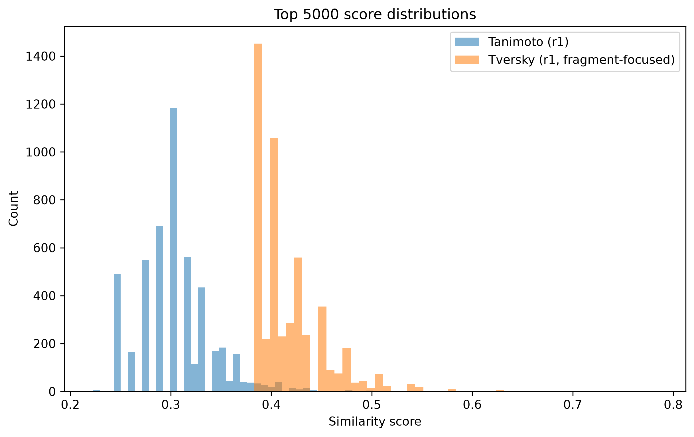
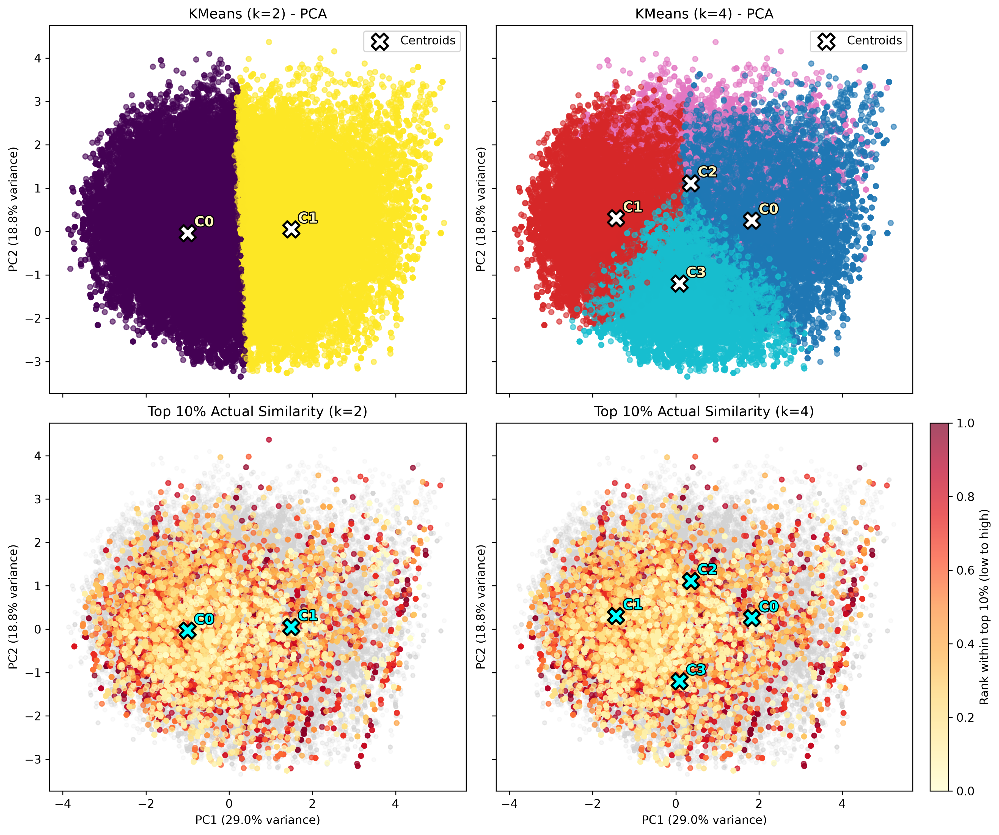
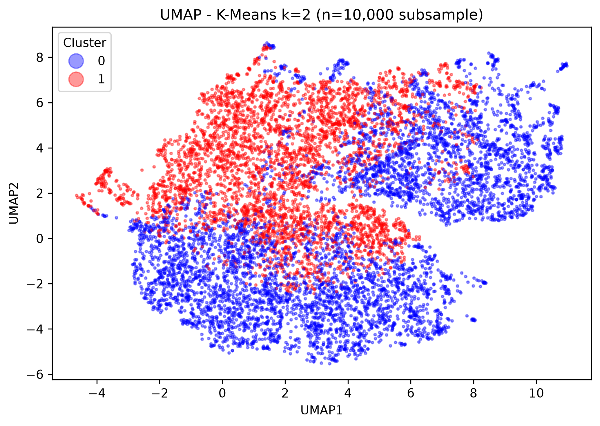
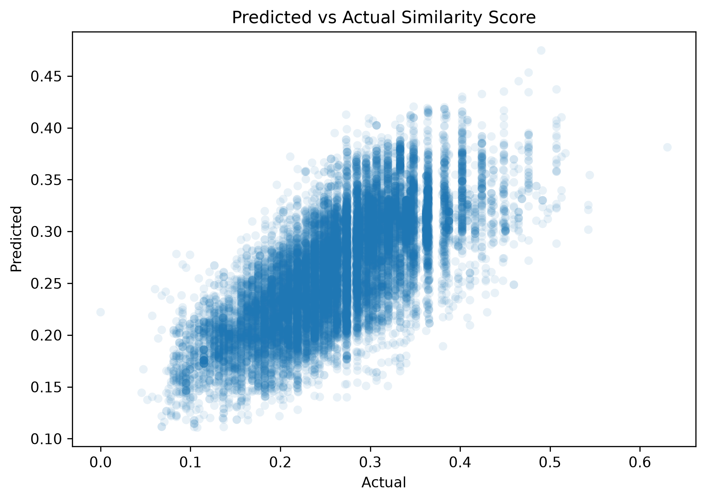
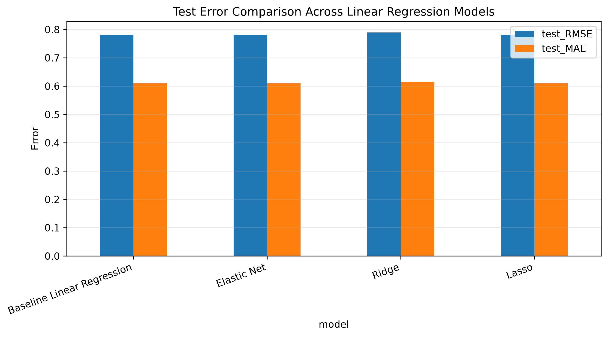

# Rapalog Discovery Pipeline Results

## Summary

The pipeline screened the COCONUT natural-product collection for compounds sharing chemical features with the FKBP12-facing region of rapamycin. After physicochemical filtering, 96,682 compounds remained for fingerprint similarity analysis, chemical-space characterization, candidate selection, docking, and regression modeling.

A stratified set of 1,000 compounds was selected for production docking. Of those, 984 successfully completed ligand preparation and AutoDock Vina docking, and 213 received Vina scores below −8.0 kcal/mol.

## Similarity Screening

Nine combinations of Morgan fingerprint and similarity settings were evaluated. The principal ranking measure used downstream was fragment-directed Tversky similarity with radius-1 Morgan fingerprints (`sim_r1_tv_frag`).

Across the 96,682 filtered compounds:

| Statistic | `sim_r1_tv_frag` |
|---|---:|
| Mean | 0.265 |
| Standard deviation | 0.073 |
| Median | 0.265 |
| 75th percentile | 0.320 |
| Maximum | 0.784 |

The similarity measures were strongly correlated, although radius-1 and radius-2 fingerprints captured different levels of local structural detail.

## Chemical-Space Clustering

Principal component analysis, K-means clustering, and UMAP were used to characterize the filtered chemical space. The primary two-cluster solution separated compounds partly by molecular size, polarity, hydrogen-bonding capacity, and amide content.

| Descriptor mean | Cluster 0 | Cluster 1 |
|---|---:|---:|
| Molecular weight | 399.4 | 469.3 |
| TPSA | 78.5 | 111.2 |
| H-bond donors | 1.56 | 2.57 |
| H-bond acceptors | 4.86 | 6.42 |
| Rings | 3.71 | 3.87 |
| Aromatic rings | 1.85 | 1.75 |
| cLogP | 3.52 | 3.45 |
| Amide count | 0.75 | 0.91 |

Cluster assignments were used as part of the stratified docking-candidate selection procedure, helping retain representation from different regions of chemical space.

## Similarity Regression

Ordinary least-squares regression was used to evaluate how well molecular descriptors predicted fragment-directed molecular similarity. The held-out test results were:

| Metric | Result |
|---|---:|
| Test R² | 0.534 |
| RMSE | 0.049 |
| MAE | 0.039 |
| Range-normalized MAE | 6.15% |
| Test observations | 19,337 |

These results indicate moderate predictive performance: the descriptor set captured part, but not all, of the structural information encoded by the molecular fingerprints.

## Production Docking

The production docking run used:

- 1,000 stratified candidate molecules;
- a 25 × 25 × 25 Å FKBP12 docking box;
- AutoDock Vina exhaustiveness of 8;
- up to 9 poses per ligand.

A total of 984 compounds completed docking successfully. Their Vina scores had the following distribution:

| Statistic | Vina score (kcal/mol) |
|---|---:|
| Mean | −7.272 |
| Standard deviation | 0.926 |
| Minimum | −9.619 |
| 25th percentile | −7.915 |
| Median | −7.350 |
| 75th percentile | −6.748 |
| Maximum | −3.604 |

A total of 213 candidates received scores below −8.0 kcal/mol.

### Highest-Ranked Candidates

| Rank | Candidate | Vina score | Fragment similarity | MW | cLogP | TPSA |
|---:|---|---:|---:|---:|---:|---:|
| 1 | NPD14003 | −9.619 | 0.295 | 443.6 | 2.41 | 90.1 |
| 2 | STL518675 | −9.592 | 0.238 | 484.6 | 3.45 | 112.3 |
| 3 | CNP0253821.1 | −9.501 | 0.190 | 409.4 | 4.56 | 85.6 |
| 4 | N-((1-(4-methylpiperazin-1-yl)cyclohexyl)methyl)-2-((4-oxo-3-phenyl-4H-chromen-7-yl)oxy)acetamide | −9.480 | 0.244 | 489.6 | 3.91 | 75.0 |
| 5 | CNP0243466.1 | −9.329 | 0.313 | 455.6 | 3.18 | 88.5 |
| 6 | CNP0342192.2 | −9.318 | 0.328 | 402.5 | 4.33 | 58.6 |
| 7 | STK621013 | −9.300 | 0.263 | 452.5 | 4.11 | 107.1 |
| 8 | AKOS032434848 | −9.270 | 0.203 | 496.5 | 2.77 | 137.1 |
| 9 | STL548852 | −9.248 | 0.253 | 491.0 | 3.88 | 83.4 |
| 10 | Pentacecilide B | −9.229 | 0.249 | 454.6 | 4.42 | 89.9 |

The highest-ranked compounds did not always have the highest fragment-similarity scores. This supports using similarity and docking as complementary screening stages rather than treating similarity as a substitute for predicted pocket binding.

## Vina-Score Regression

Four regression models were evaluated for predicting AutoDock Vina scores from molecular descriptors and fragment similarity.

| Model | Train R² | Test R² | Test RMSE | Test MAE |
|---|---:|---:|---:|---:|
| Ordinary linear regression | 0.301 | 0.301 | 0.782 | 0.610 |
| Elastic Net | 0.301 | 0.300 | 0.782 | 0.610 |
| Lasso | 0.301 | 0.300 | 0.782 | 0.610 |
| Ridge | 0.293 | 0.286 | 0.789 | 0.616 |

Regularization did not materially improve held-out performance. The approximately 0.30 test R² indicates that the selected two-dimensional descriptors and fragment-similarity score explain only part of the variation in Vina scores. Three-dimensional geometry, conformational flexibility, ligand–protein contacts, protonation state, and limitations of the docking scoring function are not fully represented by these features.

## Interpretation

The pipeline identified candidates that warrant additional computational examination, but the rankings should be treated as hypothesis-generating. A favorable Vina score is an estimate of binding favorability, not an experimentally measured affinity or proof of rapamycin-like biological activity.

Further prioritization should include pose inspection, docking reproducibility, alternative FKBP12 conformations, evaluation of possible ternary-complex compatibility, molecular dynamics where justified, and experimental binding and functional assays.